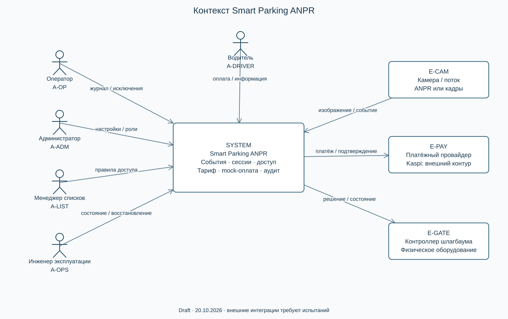
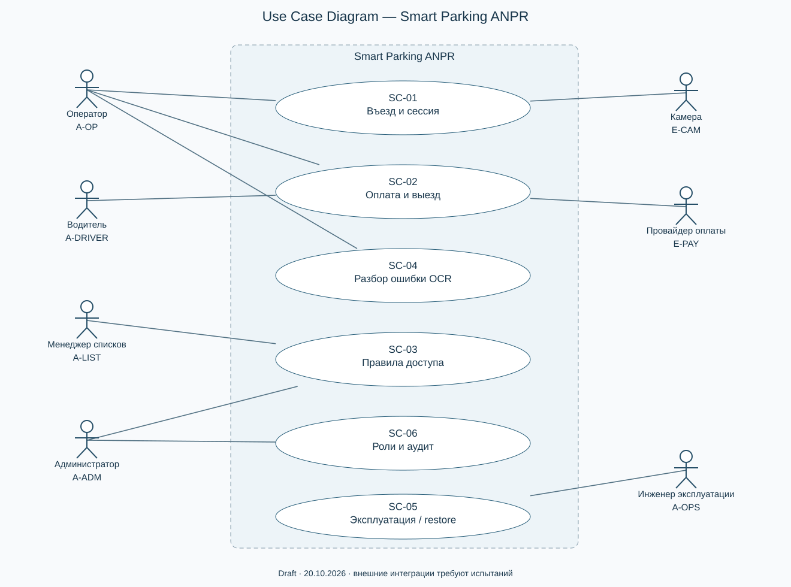
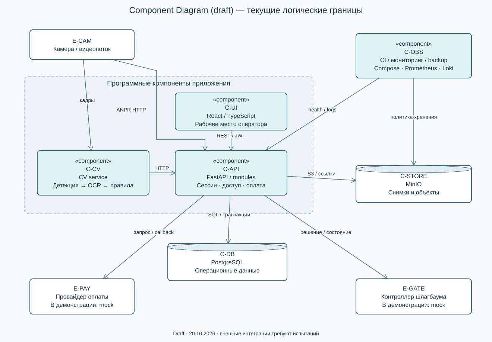

# Архитектура и согласованные схемы

Архитектура описывает текущий монорепозиторий и границы предлагаемого MVP. Компоненты и сценарии имеют те же идентификаторы, что [требования](requirements.json). Три схемы имеют редактируемый общий источник [model.json](diagrams/model.json), отдельные DOT-источники и читаемые SVG. Перегенерация из корня: `python scripts/render_submission_diagrams.py`. Graphviz и сетевой сервис для этого не требуются: SVG создаётся стандартной библиотекой Python из того же набора узлов/связей.

## 1. Контекст системы

[Редактируемый DOT](diagrams/context.dot). Оператор, администратор, менеджер списков и инженер работают с системой; водитель взаимодействует через процесс оплаты/оператора. Камера передаёт изображение/ANPR-событие; платёжный провайдер и контроллер шлагбаума находятся за внешней границей. В первой демонстрации их поведение имитируется. Схема не утверждает, что реальный контроллер или Kaspi уже подключены.

## 2. Use Case Diagram

[Редактируемый DOT](diagrams/use-cases.dot). В границе Smart Parking находятся шесть вариантов: SC-01 въезд и сессия, SC-02 оплата и выезд, SC-03 управление доступом, SC-04 разбор неопределённого номера, SC-05 эксплуатация/восстановление, SC-06 роли и аудит. Акторы показаны фигурками, варианты — эллипсами. Это диаграмма взаимодействий акторов; последовательность операций описана в UX и плане оценки.

## 3. Component Diagram — draft

[Редактируемый DOT](diagrams/components.dot). Прямоугольники `«component»` показывают логические программные компоненты, цилиндры — хранилища, внешние устройства вынесены за программную границу. Разделение не означает отдельный микросервис для каждого Python-модуля.

| ID | Реализация и ответственность | Интерфейс/данные |
|---|---|---|
| C-UI | `frontend/src/App.tsx`, страницы React | HTTP API с JWT, отображение событий/сессий/ошибок |
| C-API | `backend/src/main.py`, `modules/` | Приём XML/JSON/multipart; сессии, тарифы, оплата, списки, роли |
| C-CV | `cv/service.py`, `recognizer/` | Детекция→OCR→нормализация/агрегация; HTTP-адаптер события |
| C-DB | PostgreSQL; `models.py`, `migrations/` | Камеры, события, сессии, платежи, пользователи, аудит |
| C-STORE | MinIO; `backend/src/storage.py` | Снимки; в БД — ссылки и метаданные |
| C-OBS | `deploy/`, Compose, CI | Health, метрики/логи, backup; restore требует отдельного испытания |

## Поток, доверие и отказы

Камера с on-device ANPR может сразу отправить payload в API. Альтернативный путь: кадр/поток → CV → адаптер → тот же API. Это разные поставщики наблюдений; направление и доверие должны контролироваться до бизнес-действия. API сохраняет событие, применяет правила сессии/доступа/оплаты и фиксирует решение; UI читает результат. Снимок хранится отдельно. Транзакция БД не охватывает физический шлагбаум и внешний платёжный сервис, поэтому требуется сверка и обработка повторов.

Границы доверия: браузер→API (JWT/роль), устройство→ingest (идентификация/разрешённая сеть — к проверке), провайдер→payment callback (аутентичность/сумма/идемпотентность — до реальной оплаты), API→хранилища (отдельные секреты), инженер→инфраструктура (ограниченные права). NFR-04 задаёт проверку данных и доступа; юридическое соответствие не объявляется доказанным.

Redis предусмотрен инфраструктурой и кодом worker, но не изображён надёжным брокером основного события: подтверждённого durable контура доставки нет. Ошибка CV/камеры не разрешает проезд автоматически; сбой оплаты не считается успехом; недоступность MinIO не должна маскировать проблему снимка. В ряде путей это ещё требования, а не испытанные свойства.

## Ключевая трассировка

SC-01 → FR-01/02, NFR-03 → C-CV/C-API/C-DB → T01/T02/T15. SC-02 → FR-05/06/09 → C-UI/C-API/C-DB → T05/T06/T09. SC-03 → FR-07 → C-UI/C-API/C-DB → T07. SC-04 → FR-03/11, NFR-01 → C-CV/C-API/C-UI → T03/T11/T13. SC-05 → FR-10/12, NFR-05/06 → C-OBS и сервисы → T10/T12/T17/T18. SC-06 → FR-08, NFR-04/08 → C-UI/C-API → T08/T16/T20.
