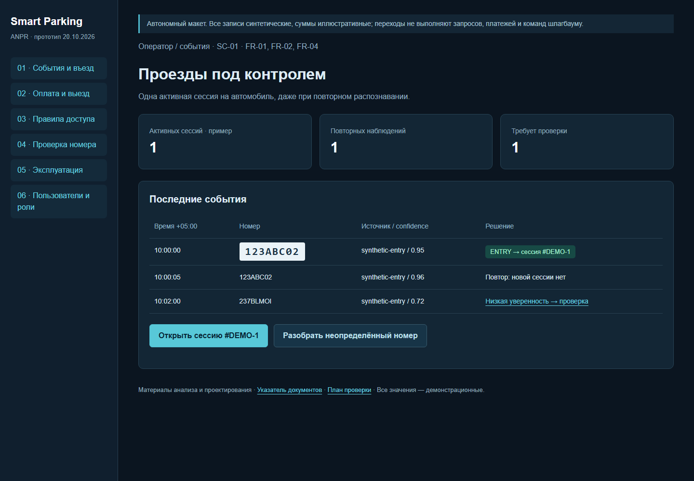

# UX, сценарии и прототип

Откройте [кликабельный макет](prototype/index.html) локально или через `python -m http.server 8086 --bind 127.0.0.1` из корня репозитория, URL `http://127.0.0.1:8086/docs/pre-defense/prototype/`. GitHub показывает исходный HTML; скачайте/клонируйте репозиторий для просмотра. Макет работает без JavaScript, сети, камеры, моделей и платежей. Данные синтетические, действия — переходы между подготовленными состояниями, а не реальные операции.

Макет повторяет навигацию и понятия существующего React UI; визуальная адаптация сделана для автономного обсуждения. Он показывает целевое взаимодействие и состояния ошибок, но не доказывает, что все проверки доступа и бизнес-правила уже реализованы.



Для телефона: [изображение мобильного макета](prototype/preview-mobile.png). На узком экране широкие таблицы прокручиваются внутри блока.

| Сценарий | Путь пользователя в макете | Реальные файлы/маршруты UI | Требования |
|---|---|---|---|
| SC-01 Въезд | События → разрешённый номер → активная сессия → повторное событие | `pages/EventsPage.tsx`, `ActiveCarsPage.tsx`, `SessionsPage.tsx`; `/events`, `/active`, `/sessions` | FR-01/02/04 |
| SC-02 Оплата и выезд | Открыть сессию → задолженность → mock-оплата → разрешённый выезд; отдельно ошибка | `SessionDetailPage.tsx`, `PaymentPage.tsx`, `PayResult.tsx`; `/sessions/:id`, `/pay/:sessionId` | FR-05/06/09 |
| SC-03 Доступ | Списки → увидеть green/yellow/red → red-сигнал → подтверждение оператором | `AccessListsPage.tsx`, `GatesPage.tsx`; `/access-lists`, `/gates` | FR-07/09 |
| SC-04 Ошибка OCR | Низкая уверенность → raw/нормализованный номер → запрос ручной проверки | `RecognizePage.tsx`, `EventsPage.tsx`; `/recognize`, `/events` | FR-03/11, NFR-01 |
| SC-05 Эксплуатация | Камеры → offline → диагностика → план восстановления | `CamerasPage.tsx`, `StreamPanel.tsx`; `/cameras` | FR-10/12, NFR-05/06 |
| SC-06 Права | Сравнить operator/list_manager/admin → запрещённое действие | `UsersPage.tsx`, `AuthContext.tsx`, `App.tsx`; `/users` | FR-08, NFR-04/08 |

## Сквозной пример

Номер `123ABC02` используется только как синтетический пример. Время — `2026-10-20T10:00:00+05:00`. Высокая уверенность и направление ENTRY дают событие, затем одну сессию. Повтор в пределах окна не создаёт вторую. На выходе сервер рассчитывает задолженность; в макете задана иллюстративная сумма 200 ₸, а не рассчитанный результат реального API. После подтверждения mock-платежа показывается решение «разрешить», отдельно от физического состояния шлагбаума. Низкая уверенность и red-доступ ведут в отдельные исключения.

## Примеры API для действующего прототипа

Для защищённых чтений сначала авторизуйтесь в Swagger `/docs` и используйте токен своего локального тестового пользователя. Токены в документы не вставляйте. Стенд изолирован; реальный Kaspi выключен. Фактические схемы — OpenAPI конкретного запуска.

```http
POST /api/v1/hikvision/anpr-event
Content-Type: application/json

{"licensePlate":"123ABC02","direction":"forward","dateTime":"2026-10-20T10:00:00+05:00","channelName":"synthetic-entry","confidenceLevel":95}
```

Ожидается 201 при валидном payload; ID и связанная сессия зависят от зарегистрированной камеры/настроек. Повторите запрос и проверьте события и активные сессии, не предполагая заранее идемпотентность транспорта.

```http
GET /api/v1/recognition/events?plate=123ABC02&page=1&limit=20
Authorization: Bearer <local-test-token>

GET /api/v1/parking-sessions/active
Authorization: Bearer <local-test-token>
```

Отдельный CV HTTP-интерфейс: `POST /recognize` с multipart-полем `file`, необязательными `engine` и `detector`; `/versions` показывает доступность адаптеров. В проверках используется template/whole на синтетическом изображении. Ни реальный OCR, ни его веса для просмотра макета не нужны.

Проверка UX: дайте трём представителям пользователей два задания (спорное событие; оплата/ошибка), не объясняя маршрут заранее. Фиксируйте успех, время, ошибочные переходы и комментарии по протоколу T19. В этой подготовке пользовательский тест не проводился.
